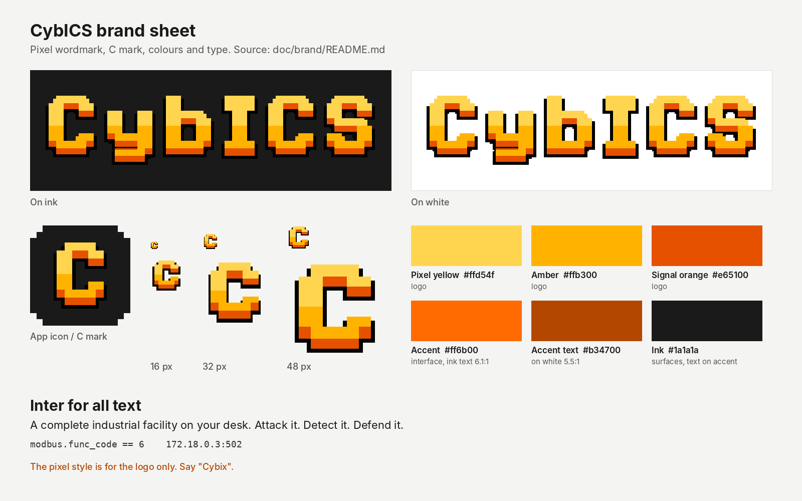

# CybICS brand guide

One page for anyone who presents, writes about or builds on CybICS: the name,
the pixel logo, the colours, the type and the voice. The files in this folder
are the only approved logo files.

## Name

- Write **CybICS**: capital C, lower-case "yb", capital "ICS". It stands for
  Cybersecurity for Industrial Control Systems.
- Say **"Cybix"**, one word.
- Lower-case `cybics` only appears in identifiers: container names, hostnames,
  file names, URLs. `CYBICS` only appears in constants. Neither belongs in prose.
- Names of the parts:

| Name | What it is |
|---|---|
| CybICS board | the PCB with the Raspberry Pi and the STM32 |
| Theory Path | the lessons on the landing page |
| CybICS Assistant | the AI chat on the landing page; the service behind it is `cybicsagent` |
| Sharky | the packet analyser on the landing page |
| CybICS IDS | the intrusion detection system |

## Logo

The logo is pixel art, and it stays pixel art. It comes in two forms:

| File | Use |
|---|---|
| [`cybics-wordmark.svg`](cybics-wordmark.svg) | the master: web pages, slides, print |
| [`cybics-wordmark.png`](cybics-wordmark.png), [`@2x`](cybics-wordmark@2x.png) | places that cannot take SVG |
| [`cybics-mark.svg`](cybics-mark.svg) | the C on its own: avatars, stickers, square spaces |
| [`favicon.ico`](favicon.ico) (16, 32, 48 px), [`apple-touch-icon.png`](apple-touch-icon.png), [`icon-512.png`](icon-512.png) | browser and app icons |
| [`social-preview.png`](social-preview.png) | the 1280×640 card for links to the repository |
| [`brand-sheet.png`](brand-sheet.png) | this guide on one page, for slides and press |

**Construction.** In the SVG's own pixels, every letter is built from blocks of
5×5 pixels, and strokes are two blocks (10 px) wide. The black drop shadow is the
letter moved down by 2 px and widened by 2 px on each side. The fill has three
bands from top to bottom: yellow, amber, and signal orange at the base.

**Why the I has bars.** Without a gap, a plain I next to the lower-case b reads
as "Cybl". The old logo solved that with a space ("Cyb ICS"), which split the
name. Bars on the I keep the name in one piece and make the capital I
unambiguous.

**Rules**

- Scale the SVG freely; it is drawn with `shape-rendering="crispEdges"` and stays
  sharp at every size. Scale the PNG only by whole numbers (2×, 3×), never by
  fractions, and never with smoothing.
- Smallest size: 20 px high on screen for the wordmark, 16 px for the mark (the
  16 px favicon has its own hand-placed pixels).
- Leave a free margin of at least the height of the C's top bar on every side.
- The logo works on dark and light backgrounds as it is. Do not add a glow, an
  outline or a box.
- Do not stretch it, recolour it, put text in the pixel style, or bring back the gap.

## Colour

| Token | Hex | Use |
|---|---|---|
| Pixel yellow | `#ffd54f` | logo only |
| Amber | `#ffb300` | logo, highlights on dark backgrounds |
| Signal orange | `#e65100` | logo |
| Accent | `#ff6b00` | the interface accent on the landing page, IDS and Theory Path |
| Accent text on light | `#b34700` | links and accent text on white (5.5:1) |
| Ink | `#1a1a1a` | dark surfaces, and text on accent fills |

The landing pages read these from `software/landing/static/css/brand.css` as
`--brand-*` custom properties.

**Status and data colours.** Outside the brand palette, the interface uses a
small fixed set with a meaning each: green `#22c55e` for success and solved,
red `#ef4444` for alarms and spoilers, and blue `#3b82f6` only as a data
series in charts. Chart series take the accent first, then amber, blue and green.
Challenge difficulty reuses green, amber and red for easy, medium and hard;
topic tags stay neutral grey. Nothing else gets a colour of its own.

The logo colours and the interface accent are deliberately close: the logo is
warm yellow-to-orange, the interface uses its orange end.

**Contrast.** White text on `#ff6b00` reaches only 2.9:1, below WCAG AA.
On accent buttons and badges use ink text (`#1a1a1a`, 6.1:1). On white, use
`#b34700` for accent text, not `#ff6b00`.

## Type

- **Inter** for all interface and document text. It ships with the landing page
  (`software/landing/static/fonts/`), so it also works offline.
- A monospace font for code, commands and addresses.
- The pixel style is for the logo only. Headings and body text are never set in a
  pixel font.

## Voice

CybICS is written for students with little IT/OT background and for the
instructors who teach them.

- Plain and specific: "22 challenges, 38 lessons", not "comprehensive".
- Explain a term the first time it appears.
- No emoji in front of bullets or headings, in documentation or in the interface.
  The interface uses its SVG icon set; the one exception is Sharky's shark.
- Honest about limits: say what the lab does not simulate.

## Describing CybICS

**One line:** A complete industrial facility on your desk. Attack it. Detect it. Defend it.

**25 words:** CybICS is an open-source ICS security training platform: a complete
industrial facility with process, PLC, HMI, gateways and IDS, on a Raspberry Pi
board or in Docker.

**60 words:** CybICS is an open-source training platform for industrial control
system security. It recreates a complete industrial facility: a physical process,
an OpenPLC controller, a FUXA HMI, OPC-UA and S7comm services, an engineering
workstation and an IDS, speaking Modbus TCP, S7comm and OPC-UA. Students attack it,
detect the attacks and defend it, guided by 38 Theory Path lessons and 22 CTF
challenges. It runs in Docker or on a custom Raspberry Pi board.

## Photos and screenshots

- The board: [`../pics/cybics.png`](../pics/cybics.png). It shows the v1.0 board;
  replace it when the current revision is photographed.
- The landing page: [`../pics/landing.png`](../pics/landing.png).

## Where the brand assets are used

| Place | File |
|---|---|
| README header | `doc/brand/cybics-wordmark.svg` |
| Landing page header and hero | `software/landing/pics/cybics-wordmark.svg` |
| Landing page icon rail (collapsed or phone) | `software/landing/pics/cybics-mark.svg` |
| Landing page favicon and touch icon | `software/landing/pics/favicon.ico`, `apple-touch-icon.png` |
| IDS dashboard header, favicon, Inter | `software/ids/static/` |
| Virtual hardware page | `software/hwio-virtual/pics/cybics-wordmark.svg`, `favicon.ico` |
| Shared tokens and Inter for the landing pages | `software/landing/static/css/brand.css` |
| Chat button and assistant avatar | `software/landing/pics/cybics-mark.svg` |
| GitHub social preview | `doc/brand/social-preview.png`, uploaded under Settings → General → Social preview |

`doc/pics/CybICS_logo.png` and `software/landing/pics/CybICS_logo.png` are the
new wordmark at 3×, kept under their old name so existing links keep working.
