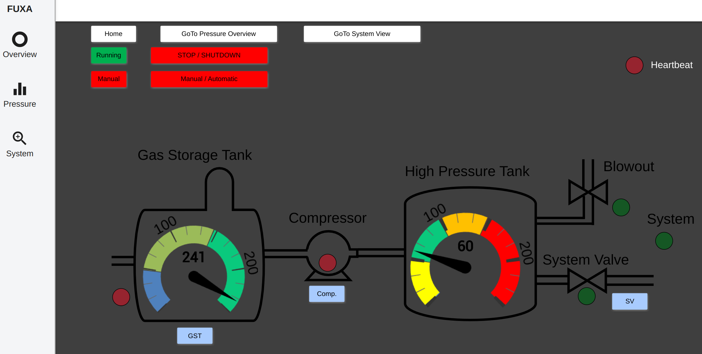
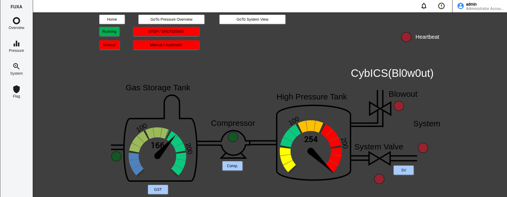

# Understanding the Physical Process

> **MITRE ATT&CK for ICS:** `Impair Process Control` | [T0831 - Manipulation of Control](https://attack.mitre.org/techniques/T0831/)

## Overview
Every attack on an industrial facility ends in the physical world: a tank that overfills, a valve that opens at the wrong time, a machine that stops. Before attacking CybICS, learn what it controls.

The CybICS plant moves gas from a gas storage tank (GST) into a high-pressure tank (HPT). A compressor pushes gas from the GST into the HPT, a system valve lets the downstream process draw it off again, and a supply signal refills the GST. The OpenPLC controller reads the two pressures and switches these actuators to keep the HPT in its normal band. A mechanical blow-out valve protects the HPT if the pressure gets too high.

The operator watches all of this on the FUXA HMI, and can take over in manual mode. In this challenge you are that operator.

The [Theory Path lesson on the process](/#theory:/theory/physical_process) explains the control rules and the numbers behind them.

## Manual Control Exercise
Try to control the process manually as an operator via the FUXA HMI.

### Steps
1. Open **FUXA** from the dashboard's sidebar ([open FUXA in a new tab](/#fuxa)), or browse to port 1881 of the CybICS host
2. Login with the credentials `operator:operator`
3. Switch to the system view
4. Click the red button "Manual / Automatic"
5. Control the different valves and operate the system manually

## Task
The flag has the format `CybICS(flag)`.

Your objective is to trigger the blowout on the system. The physical process works as follows:

- The **System Valve (SV)** controls whether gas can flow out of the High Pressure Tank (HPT).
- The **Compressor (C)** pumps gas from the storage tank into the HPT, increasing its pressure.
- If the System Valve is **closed** while the **Compressor is running**, pressure in the High Pressure Tank (HPT) will rise continuously because the gas has no path to escape.
- When the pressure exceeds a critical threshold, the **Blowout (BO)** safety event is triggered.

Using the manual control mode on the FUXA HMI, manipulate the valves and compressor to create the unsafe overpressure condition that causes the blowout.

## Security Framework References

  
Click to expand

### MITRE ATT&CK for ICS

| Tactic | Technique | ID | Description |
|--------|-----------|-----|-------------|
| Impair Process Control | Manipulation of Control | [T0831](https://attack.mitre.org/techniques/T0831/) | Adversaries may manipulate physical process control within the industrial environment to cause a disruption |

**Why this matters:** This training demonstrates how an operator (or attacker with operator access) can manipulate process control parameters to cause unsafe conditions. In real-world attacks like Stuxnet or TRITON, adversaries manipulated control systems to cause physical damage or safety incidents. Understanding normal process operation is essential before learning to detect malicious manipulation.

### MITRE D3FEND - Defensive Countermeasures

| Technique | ID | Description |
|-----------|-----|-------------|
| Operational Process Monitoring | [D3-OPM](https://d3fend.mitre.org/technique/d3f:OperationalProcessMonitoring/) | Monitoring operational processes for anomalies that may indicate compromise |
| Physical Environment Monitoring | [D3-PEM](https://d3fend.mitre.org/technique/d3f:PhysicalEnvironmentMonitoring/) | Monitoring physical environment conditions to detect abnormal states |

### NIST SP 800-82r3 Reference

| Control Family | Controls | Relevance |
|----------------|----------|-----------|
| **Physical and Environmental Protection (PE)** | PE-3, PE-6 | Physical access control and monitoring of OT environments |
| **System and Information Integrity (SI)** | SI-4, SI-13 | System monitoring and predictive maintenance to detect unsafe process states |

**Why NIST 800-82r3 matters here:** Understanding the physical process is foundational to implementing effective security controls. NIST 800-82r3 Section 5 emphasizes that OT security must account for the unique characteristics of physical processes, including safety implications of process manipulation. This training helps you understand what "normal" looks like—essential for detecting anomalies later.

## Hints

The flag appears on the FUXA HMI when the blowout is triggered.

## Solution

After login on the FUXA dashboard switch to the "System" view.
  By closing the "System Valve" (SV) and enabling the Compressor (C),
  the pressure is rising.
  After a certain time, the pressure in the High Pressure Tank (HPT)
  gets a critical level and the Blowout (BO) will be opened.

**Flag:** `CybICS(Bl0w0ut)`

  
